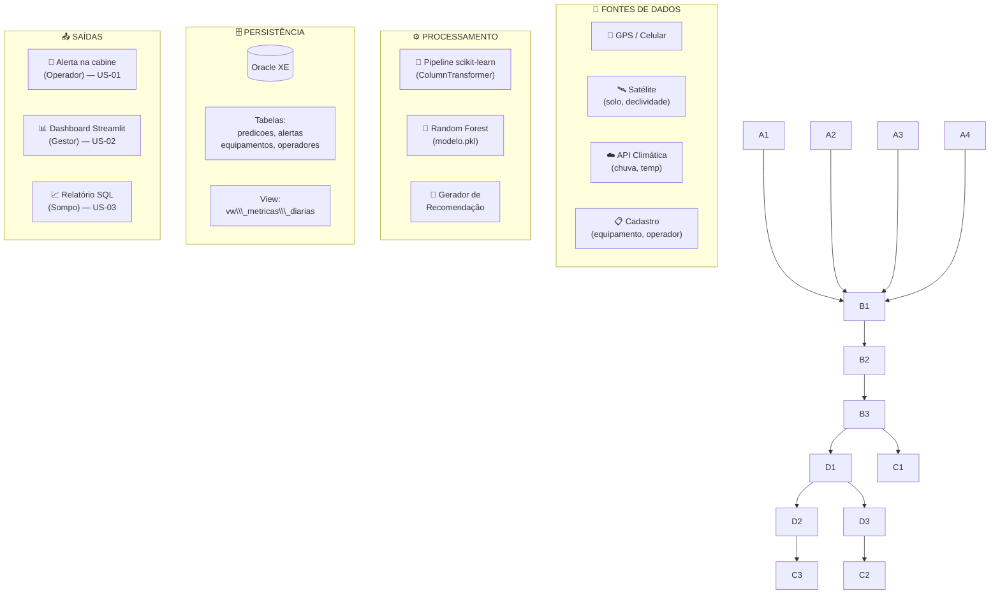
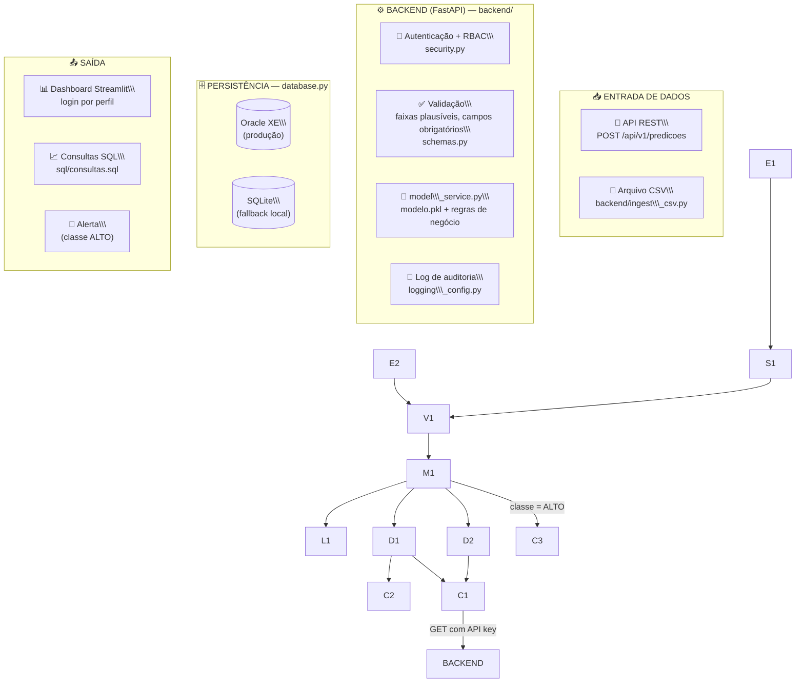

# 🌾 Sompo AgroPredict — Sprint 3

> \\\*\\\*Do reativo ao preditivo: prevenção de riscos operacionais em equipamentos agrícolas.\\\*\\\*

[!\[Sprint](https://img.shields.io/badge/Sprint-3-2C5F2D)](#)
[!\[Status](https://img.shields.io/badge/Status-Integração%20end--to--end-2C5F2D)](#)
[!\[Acurácia](https://img.shields.io/badge/Acurácia%20%28CV%29-89.6%25-2C5F2D)](#)
[!\[Challenge](https://img.shields.io/badge/Challenge-Sompo%20×%20FIAP-1A2E1A)](#)

\---

## 📌 Sobre esta entrega

Esta é a **Sprint 3** do Challenge Sompo. A Sprint 2 entregou os módulos isolados (dataset, modelo treinado, schema Oracle, dashboard); esta Sprint os integra em **um fluxo único e funcional**, com um **backend de orquestração** novo (`backend/`) que conecta entrada de dados → banco → modelo → score de risco → dashboard, com autenticação por perfil e trilha de auditoria. As entregas centrais são:

* **Backend FastAPI** (`backend/`) orquestrando o pipeline completo, com duas vias de entrada (API REST e CSV em lote)
* **Controle de acesso por perfil** (operador / gestor / analista) via API key + RBAC, aplicado a cada endpoint
* **Logs de auditoria** rastreando entradas, decisões do modelo e ações sobre alertas
* **Dashboard Streamlit atualizado** — login por perfil, cálculo em tempo real e registro oficial via backend
* **Camada de banco desacoplada** — Oracle XE (produção, mesmo schema da Sprint 2) ou SQLite (fallback automático para desenvolvimento/demo sem infraestrutura)
* Mantido da Sprint 2: modelo Random Forest (89.6% acurácia CV), dataset v2 (1000 linhas, 8 features), schema Oracle XE

### Evolução em relação à Sprint 2

|Aspecto|Sprint 2|Sprint 3|
|-|-|-|
|Integração|Módulos isolados (script de ingestão manual)|**Backend único** orquestrando entrada→banco→modelo→saída|
|Entrada de dados|Script `inserir\\\_predicoes.py` rodado manualmente|**API REST** (`POST /api/v1/predicoes`) + **ingestão CSV em lote**, ambas com a mesma validação|
|Segurança|Prevista em diretrizes de design|**Implementada**: API key por perfil, RBAC por endpoint, sanitização de inputs, faixas plausíveis|
|Logs/auditoria|Trilha apenas na tabela `alertas`|**Logs estruturados** (`logs/agropredict.log`) de toda entrada, decisão e ação|
|Dashboard|Consulta direta ao Oracle|**Consome o backend** via API, com login por perfil e permissões distintas|
|Banco|Só Oracle XE|Oracle XE **ou** SQLite (fallback automático, mesma interface de código)|

### Evolução Sprint 1 → Sprint 2 (mantido para histórico)

|Aspecto|Sprint 1|Sprint 2|
|-|-|-|
|Modelo|Proposto, não implementado|Treinado, validado, exportado (`modelo.pkl`)|
|Dataset|5 features, exemplo pequeno|**8 features**, **1000 linhas** estratificadas|
|Persistência|Conceitual|**Oracle XE** com schema + scripts de ingestão|
|Dashboard|Mockups estáticos|**Streamlit funcional** com inputs reais|
|User Stories|Implícitas nas personas|**Formalizadas** em Dado/Quando/Então|
|Documentação|README + slides|README v2 + notebook + scripts SQL|

### Incorporação do feedback da Sprint 1

> \\\*"A oportunidade principal de evolução está nas User Stories, que aparecem apenas implícitas dentro das personas... O dataset também pode ser ampliado em variáveis nas próximas iterações."\\\*

**O que foi feito:**

* ✅ 3 User Stories formalizadas (uma por persona) em `docs/user\\\_stories.md` com critérios de aceite Dado/Quando/Então
* ✅ Dataset ampliado de 5 para **8 variáveis** (novas: `temperatura`, `idade\\\_maquina`, `horas\\\_operacao`)
* ✅ Volume ampliado de \~50 para **1000 linhas** com geração estratificada (3 cenários)

\---

## 📑 Sumário

1. [Estrutura do Repositório](#1-estrutura-do-repositório)
2. [Como Executar](#2-como-executar)
2.1[video Sprint 2](https://www.youtube.com/watch?v=FTL-k7kCKbQ)
3. [Dataset v2](#3-dataset-v2)
4. [Modelo Preditivo](#4-modelo-preditivo)
5. [Camada SQL (Oracle XE)](#5-camada-sql-oracle-xe)
6. [Dashboard Streamlit](#6-dashboard-streamlit)
7. [Arquitetura Consolidada](#7-arquitetura-consolidada)
8. [Segurança e Governança](#8-segurança-e-governança)
9. [User Stories](#9-user-stories)
10. [Resultados e Métricas](#10-resultados-e-métricas)
11. [Próximas Sprints](#11-próximas-sprints)
12. [Vídeo de Apresentação](#12-vídeo-de-apresentação)
13. [Equipe e Divisão de Tarefas](#13-equipe-e-divisão-de-tarefas)
14. [**Sprint 3 — Backend de Integração End-to-End**](#14-sprint-3--backend-de-integração-end-to-end)
15. [**Arquitetura Integrada (Sprint 3)**](#15-arquitetura-integrada-sprint-3)
16. [**Segurança Implementada (Sprint 3)**](#16-segurança-implementada-sprint-3)

\---

## 1\. Estrutura do Repositório

```
sompo-agropredict/
│
├── README.md                          # Este arquivo
│
├── data/
│   ├── gerar\\\_dataset\\\_v2.py            # Script Python de geração estratificada
│   ├── dataset\\\_v2.csv                 # 1000 linhas, 8 features
│   └── agropredict\\\_local.db           # (gerado em runtime) SQLite fallback, gitignored
│
├── modelo/
│   ├── random\\\_forest.ipynb            # Notebook completo (42 células)
│   └── modelo.pkl                     # Pipeline serializado (preproc + RF)
│
├── sql/
│   ├── schema.sql                     # DDL Oracle XE: 4 tabelas + view + sequences
│   ├── inserir\\\_predicoes.py           # Script de ingestão (Sprint 2, uso manual/batch)
│   └── consultas.sql                  # 6 queries de análise
│
├── backend/                           # 🆕 Sprint 3 — orquestração end-to-end
│   ├── main.py                        # API FastAPI (endpoints REST)
│   ├── database.py                    # Repositório Oracle XE / SQLite (mesma interface)
│   ├── model\\\_service.py               # Carrega modelo.pkl, aplica regras de negócio
│   ├── schemas.py                     # Validação de entrada (Pydantic)
│   ├── security.py                    # Autenticação por API key + RBAC + sanitização
│   ├── logging\\\_config.py              # Logs estruturados de auditoria
│   ├── ingest\\\_csv.py                  # Ingestão em lote via CSV (2ª via de entrada)
│   └── config.py                      # Configuração central (env vars, thresholds)
│
├── dashboard/
│   └── app.py                         # Dashboard Streamlit — consome o backend
│
├── docs/
│   └── user\\\_stories.md                # 3 US formalizadas (Dado/Quando/Então)
│
├── logs/                              # 🆕 gerado em runtime — logs/agropredict.log
│
└── prints/                            # Capturas de tela e gráficos
    ├── 01\\\_distribuicao\\\_classes.png
    ├── 02\\\_boxplot\\\_features.png
    ├── 03\\\_correlacao.png
    ├── 04\\\_operacao\\\_vs\\\_risco.png
    ├── 05\\\_matriz\\\_confusao.png
    ├── 06\\\_feature\\\_importance.png
    └── 07\\\_dashboard\\\_baixo.png
```

\---

## 2\. Como Executar

### Pré-requisitos

```bash
pip install -r requirements.txt
```

> A partir da Sprint 3, `requirements.txt` já inclui `fastapi`, `uvicorn` e `requests`
> (backend) além das dependências de ML/dashboard da Sprint 2.

### Passo 1 — Gerar o dataset (se ainda não existir)

```bash
cd data/
python gerar\\\_dataset\\\_v2.py
cd ..
# Saída: data/dataset\\\_v2.csv (1000 linhas, distribuição \\\~70/14/16 BAIXO/MEDIO/ALTO)
```

### Passo 2 — Treinar o modelo (se `modelo/modelo.pkl` ainda não existir)

```bash
cd modelo/
jupyter notebook random\\\_forest.ipynb
# Executar todas as células → gera modelo.pkl + 6 imagens em ../prints/
cd ..
```

### Passo 3 — Escolher o backend de banco de dados

O backend (`backend/`) funciona com **dois bancos intercambiáveis**, controlados
pela variável de ambiente `DB\\\_BACKEND`:

|`DB\\\_BACKEND`|Quando usar|Setup|
|-|-|-|
|`sqlite` (**default**)|Desenvolvimento, demo, avaliação sem infraestrutura Oracle|Nenhum — schema é criado automaticamente em `data/agropredict\\\_local.db` na primeira execução|
|`oracle`|Ambiente com Oracle XE disponível (mesmo schema da Sprint 2)|Ver abaixo|

**Setup do Oracle XE (opcional):**

```bash
# 1. Conectar no Oracle (seu usuário e senha)
sqlplus system/admin@XE

# 2. Executar schema (cria 4 tabelas, 1 view, 2 sequences, 6 registros seed)
@sql/schema.sql
```

```bash
# 3. Configurar variáveis de ambiente antes de subir o backend
export DB\\\_BACKEND=oracle
export ORACLE\\\_USER=system
export ORACLE\\\_PASSWORD=admin
export ORACLE\\\_DSN=localhost:1521/XE
```

### Passo 4 — Subir o backend (orquestração end-to-end)

```bash
# (opcional) definir tokens de API por perfil — senão usa defaults de dev
export TOKEN\\\_OPERADOR=op-token-dev-0001
export TOKEN\\\_GESTOR=ge-token-dev-0002
export TOKEN\\\_ANALISTA=an-token-dev-0003

uvicorn backend.main:app --reload --port 8000
# Docs interativas (Swagger): http://localhost:8000/docs
# Health check:               http://localhost:8000/health
```

### Passo 5 — Rodar o dashboard (consome o backend)

Em outro terminal:

```bash
streamlit run dashboard/app.py
# Acessar: http://localhost:8501
```

No dashboard, escolha o **perfil de acesso** (operador/gestor/analista) na
barra lateral — isso define o token enviado ao backend e o que fica visível
(ex.: operador não vê histórico completo nem métricas agregadas).

### (Alternativa) Ingestão em lote via CSV, sem passar pela API

```bash
python -m backend.ingest\\\_csv --csv data/dataset\\\_v2.csv --n 100
```

> O dashboard \\\*\\\*funciona com Oracle XE ou SQLite\\\*\\\* — a troca é feita apenas pela
> variável `DB\\\_BACKEND`, sem alterar código de negócio.

[link para o vídeo (Sprint 2)](https://www.youtube.com/watch?v=FTL-k7kCKbQ) · vídeo da Sprint 3: ver [seção 14](#14-sprint-3--backend-de-integração-end-to-end)

\---

## 3\. Dataset v2

### Features (8 variáveis)

|Variável|Tipo|Unidade|Fonte em produção|Sprint 1 / Sprint 2|
|-|-|-|-|-|
|`umidade\\\_solo`|Numérica|%|Satélite Sentinel/Planet|S1|
|`declividade`|Numérica|%|Mapas GIS / satélite|S1|
|`chuva\\\_24h`|Numérica|mm|Open-Meteo / INMET|S1|
|`velocidade`|Numérica|km/h|GPS do celular|S1|
|`status\\\_operacao`|Categórica|—|Input do operador|S1|
|**`temperatura`**|**Numérica**|**°C**|**API climática**|**🆕 S2**|
|**`idade\\\_maquina`**|**Numérica**|**anos**|**Cadastro do equipamento**|**🆕 S2**|
|**`horas\\\_operacao`**|**Numérica**|**h**|**GPS + log do dia**|**🆕 S2**|

### Justificativa das novas variáveis

* **`temperatura`** — Calor extremo combinado com jornada longa eleva risco de fadiga do operador e superaquecimento mecânico
* **`idade\\\_maquina`** — Máquinas antigas têm probabilidade maior de falha mecânica, especialmente sob uso intenso
* **`horas\\\_operacao`** — Fadiga do operador e desgaste térmico crescem ao longo do dia

Todas as 3 novas variáveis seguem o princípio da Sprint 1: **captáveis por fontes externas à máquina** (celular, cadastro, API), viabilizando adoção em frotas legadas sem telemetria proprietária.

### Geração estratificada

O dataset é gerado em 3 cenários proporcionais para garantir representatividade das classes:

|Cenário|Proporção|Distribuições deslocadas|
|-|-|-|
|**Seguro**|45%|Umidade baixa, declividade baixa, velocidade moderada|
|**Limite**|35%|Variáveis em zonas de transição|
|**Crítico**|20%|Múltiplos fatores adversos sobrepostos|

**Distribuição final das classes:** 73% BAIXO · 10% MÉDIO · 17% ALTO (refletindo a realidade do agro: maioria das operações é segura).

\---

## 4\. Modelo Preditivo

### Random Forest Classifier — justificativa

|Critério|Por que Random Forest|
|-|-|
|**Interações não-lineares**|Captura naturalmente regras como "umidade alta + chuva = atolamento"|
|**Dataset moderado (1000 linhas)**|Tamanho ideal para RF — pequeno demais para deep learning, grande demais para uma árvore única|
|**Features mistas**|Numéricas + categóricas sem necessidade de normalização|
|**Interpretabilidade**|Feature importance nativa → fundamental para seguro e LGPD|

### Hiperparâmetros otimizados (grid search manual de 5 combinações)

```python
RandomForestClassifier(
    n\\\_estimators=300,
    min\\\_samples\\\_split=2,
    min\\\_samples\\\_leaf=2,        # leve regularização
    max\\\_features='sqrt',
    class\\\_weight='balanced',   # compensa desbalanceamento
    random\\\_state=42
)
```

### Pipeline completo

```
Entrada (8 features)
    ↓
ColumnTransformer:
    • numéricas (7) → passthrough
    • status\\\_operacao → OneHotEncoder(drop='first')
    ↓
RandomForestClassifier
    ↓
Saída: classe (BAIXO/MÉDIO/ALTO) + score (0–100) + probabilidades
```

Todo o pipeline é serializado em `modelo.pkl` — o dashboard e o script de ingestão SQL só fazem `joblib.load()`.

\---

## 5\. Camada SQL (Oracle XE)

### Modelo de dados

```mermaid
erDiagram
    EQUIPAMENTOS ||--o{ PREDICOES : "gera"
    OPERADORES   ||--o{ PREDICOES : "executa"
    PREDICOES    ||--o| ALERTAS   : "dispara"

    EQUIPAMENTOS {
        NUMBER id\\\_equipamento PK
        VARCHAR modelo
        VARCHAR fabricante
        NUMBER ano\\\_fabricacao
        VARCHAR fazenda
    }

    OPERADORES {
        NUMBER id\\\_operador PK
        VARCHAR nome
        VARCHAR cpf
        VARCHAR fazenda
    }

    PREDICOES {
        NUMBER id\\\_predicao PK
        TIMESTAMP data\\\_hora
        NUMBER id\\\_equipamento FK
        NUMBER id\\\_operador FK
        NUMBER score\\\_risco
        VARCHAR classe\\\_risco
        VARCHAR recomendacao
        NUMBER prob\\\_baixo
        NUMBER prob\\\_medio
        NUMBER prob\\\_alto
        VARCHAR versao\\\_modelo
    }

    ALERTAS {
        NUMBER id\\\_alerta PK
        NUMBER id\\\_predicao FK
        TIMESTAMP data\\\_emissao
        VARCHAR acao\\\_tomada
    }
```

### Decisões de design

* **Sequences** (`seq\\\_predicao`, `seq\\\_alerta`) para IDs auto-incrementais
* **Indexes** em `predicoes(data\\\_hora)`, `(classe\\\_risco)`, `(id\\\_equipamento)` para queries do dashboard
* **View `vw\\\_metricas\\\_diarias`** consolidando agregações por dia (alimenta o dashboard)
* **Coluna `versao\\\_modelo`** em `predicoes` para rastreabilidade (LGPD / auditoria)
* **CHECK constraints** garantem integridade (`classe\\\_risco IN ('BAIXO','MEDIO','ALTO')`)

### Queries-chave (`sql/consultas.sql`)

1. Distribuição geral de risco
2. Top 10 predições mais críticas
3. Score médio por equipamento (visão do gestor)
4. Taxa de aderência dos operadores aos alertas (relatório Sompo)
5. Identificação de fatores de risco predominantes
6. Métricas diárias consolidadas

\---

## 6\. Dashboard Streamlit

O dashboard (`dashboard/app.py`) é a interface funcional que demonstra o ciclo completo: input → modelo → saída → persistência.

### Funcionalidades

* **Calculadora de risco em tempo real**: sliders e selectbox para as 8 features, predição instantânea
* **Card de resultado** com cor por classe (🟢 / 🟡 / 🔴), score 0–100 e recomendação contextual
* **Probabilidades** de cada classe com barras de progresso
* **Indicadores de risco por variável** (⚠️ Alta / OK) baseados em thresholds do domínio
* **Feature importance** do modelo treinado (transparência das decisões)
* **Histórico** vindo do Oracle XE quando conectado, ou da sessão local quando não

> \\\*\\\*Atualizado na Sprint 3:\\\*\\\* o dashboard agora tem \\\*\\\*login por perfil\\\*\\\* e
> \\\*\\\*registra oficialmente\\\*\\\* cada operação através do backend (`POST /api/v1/predicoes`),
> em vez de só calcular localmente. Histórico, métricas e alertas passam a vir do
> backend via API (`GET`), respeitando o controle de acesso por perfil. Detalhes
> completos na \\\[seção 14](#14-sprint-3--backend-de-integração-end-to-end).

### Modos de operação

|Modo|Quando|Comportamento|
|-|-|-|
|**Com Oracle**|`ORACLE\\\_DSN` configurado e schema criado|Lê histórico do banco, mostra dashboards consolidados|
|**Sem Oracle**|Conexão indisponível|Funciona normalmente, histórico em sessão (não persistente)|

### Print do dashboard

Ver `prints/07\\\_dashboard\\\_baixo.png` — cenário em condições seguras (classe BAIXO).

\---

## 7\. Arquitetura Consolidada



### Mudanças em relação à arquitetura da Sprint 1

* ➕ **Camada de Persistência explicitada** (Oracle XE)
* ➕ **Rastreabilidade às User Stories** (cada saída ligada à US correspondente)
* ➕ **View agregada** alimentando o dashboard sem queries pesadas

\---

## 8\. Segurança e Governança

A solução manipula dados operacionais sensíveis (geolocalização de operadores, histórico de comportamento, dados de sinistro), e o briefing exige garantia de **controle de acesso e integridade de dados**. Esta seção distingue o que já está **implementado na Sprint 2** do que segue como **diretriz de design** para as próximas Sprints.

### 8.1 Implementado nesta Sprint

|Controle|Onde|Como|
|-|-|-|
|**Integridade de domínio**|`sql/schema.sql`|`CHECK` constraints garantem que `classe\\\_risco ∈ {BAIXO, MEDIO, ALTO}` e `status\\\_operacao ∈ {Colheita, Deslocamento, Manobra}` — entradas inválidas são rejeitadas pelo banco|
|**Integridade referencial**|`sql/schema.sql`|`FOREIGN KEY` ligando `predicoes` a `equipamentos` e `operadores`; impede predições órfãs|
|**Rastreabilidade de decisão automatizada**|`predicoes.versao\\\_modelo` + `prob\\\_baixo/medio/alto`|Cada predição registra a versão do modelo e as probabilidades — base para auditoria (LGPD art. 20, direito a revisão de decisão automatizada)|
|**Validação de faixas (sanity check)**|`data/gerar\\\_dataset\\\_v2.py` (`np.clip`)|Todas as features são limitadas a faixas fisicamente plausíveis antes de entrar no modelo|
|**Trilha de auditoria de alertas**|tabela `alertas` (`acao\\\_tomada`, `data\\\_acao`)|Registra se o operador respeitou ou ignorou cada alerta — evidência para análise forense de sinistro|

### 8.2 Controle de acesso por perfil (RBAC)

O modelo de dados foi desenhado para suportar segregação por persona. Cada perfil acessa apenas o subconjunto pertinente:

* **Operador** → apenas predições do próprio equipamento/operação em tempo real (filtro por `id\\\_operador`)
* **Gestor de frota** → dados agregados da própria fazenda (filtro por `fazenda` em `equipamentos`/`operadores`)
* **Analista Sompo** → portfólio agregado e detalhe de clientes da própria carteira

> \\\*\\\*Implementação prevista (Sprint 3):\\\*\\\* a separação lógica já existe no schema (campo `fazenda`, FKs por operador/equipamento). A aplicação dos perfis via \\\*roles\\\* do Oracle (`CREATE ROLE`, `GRANT SELECT`) e autenticação na camada de aplicação será adicionada na próxima Sprint.

### 8.3 Diretrizes de design (Sprints futuras)

Mantidas da Sprint 1, a serem implementadas conforme o protótipo evolui:

* **Autenticação:** login + senha forte; MFA para o painel da Sompo; tokens JWT de expiração curta para sessões de API
* **Criptografia:** TLS 1.2+ em trânsito; AES-256 em repouso para dados sensíveis
* **LGPD:** finalidade específica (operação segura), base legal documentada (legítimo interesse + execução de contrato), direito ao esquecimento ao fim do contrato, anonimização em relatórios agregados de portfólio
* **Defesa contra abuso:** sanitização de entradas no app e dashboard, rate limiting nas APIs públicas, monitoramento contra *adversarial inputs*

> \\\*\\\*Por que separar implementado de previsto:\\\*\\\* controles como MFA, criptografia em repouso e roles de banco dependem de infraestrutura de produção (servidor de autenticação, gestão de chaves) que está fora do escopo do MVP acadêmico. O que \\\*\\\*dependia só de modelagem de dados\\\*\\\* — constraints, FKs, rastreabilidade, trilha de auditoria — foi efetivamente implementado nesta Sprint.

\---

## 9\. User Stories

Documento completo em [`docs/user\\\_stories.md`](docs/user_stories.md).

|ID|Persona|Resumo|
|-|-|-|
|**US-01**|Operador de Campo|Alerta preventivo em tempo real com sinalização visual + sonora|
|**US-02**|Gestor de Frota|Dashboard tático com ranking de equipamentos e drilldown|
|**US-03**|Analista Sompo|Relatórios de aderência aos alertas e análise forense de sinistros|

Cada US tem **4 critérios de aceite** no formato Dado/Quando/Então, totalizando **12 critérios** rastreáveis aos entregáveis técnicos da Sprint 2.

\---

## 10\. Resultados e Métricas

### Comparação Baseline × Random Forest

|Modelo|Acurácia (teste)|F1 macro (teste)|Acurácia (CV 5-fold)|F1 macro (CV 5-fold)|
|-|-|-|-|-|
|Logistic Regression (baseline)|83.2%|79.3%|—|—|
|**Random Forest (final)**|**89.2%**|**81.7%**|**89.6% (±2.3%)**|**81.4% (±4.8%)**|

> O dataset foi rebalanceado para reforçar a classe MÉDIO (de \\\~10% para \\\~14% das amostras), que é a mais difícil por ser fronteiriça entre BAIXO e ALTO. Isso elevou o F1 macro do modelo (de 76% para 81%), tornando-o mais equilibrado entre as três classes — ao custo de \\\~1 ponto de acurácia global, um trade-off favorável.

### Matriz de Confusão (teste set, n=250)

```
              Predito
Real      BAIXO  MEDIO  ALTO
BAIXO     \\\[162    9      0]
MEDIO     \\\[  6   23      5]
ALTO      \\\[  0    7     38]
```

**Análise:** após o rebalanceamento, a classe MÉDIO acerta **23 de 34 (recall 68%)**, contra apenas 16% antes — o ganho principal desta revisão. ALTO mantém **38/45 recall (84%)** — crítico no domínio, já que falso negativo de ALTO seria deixar passar uma situação perigosa. Não há confusão entre os extremos (BAIXO↔ALTO = 0 casos), o que é o comportamento desejado: os erros que restam são entre classes adjacentes.

### Feature Importance (top 5)

Detalhes no notebook seção 10. Variáveis com maior peso na decisão:

1. `umidade\\\_solo`
2. `velocidade`
3. `temperatura`
4. `chuva\\\_24h`
5. `declividade`

A justificativa do modelo a uma decisão de classificação ALTO sempre pode ser explicada apontando a combinação das 2–3 variáveis dominantes (transparência ↔ LGPD).

\---

## 11\. Próximas Sprints

|Sprint|Foco|Entregas Principais|
|-|-|-|
|Sprint 1 ✅|Estrutura inicial e proposta documentada|README, dataset simulado, mockups, vídeo|
|Sprint 2 ✅|Modelo preditivo + integração|Notebook treinado, SQL Oracle, dashboard funcional, US formalizadas|
|**Sprint 3 ✅**|**Integração end-to-end (MVP \~60%)**|**Backend FastAPI orquestrando entrada→banco→modelo→saída, RBAC, logs de auditoria, dashboard integrado**|
|Sprint Final|Protótipo completo + apresentação|Autenticação real (JWT), deploy, roles nativas do Oracle, vídeo final, pitch para banca no Festival NEXT|

\---

## 12\. Vídeo de Apresentação

🎬 **Vídeo Sprint 2:** [assista aqui](https://www.youtube.com/watch?v=FTL-k7kCKbQ)

🎬 **Vídeo Sprint 3 (até 5 min):** *\[inserir link "não listado" do YouTube aqui após gravação]*

Conteúdo previsto para o vídeo da Sprint 3:

1. Demonstração do fluxo integrado de ponta a ponta: entrada de dado (API ou CSV) → score → interface
2. Login por perfil no dashboard e diferença de permissões (operador × gestor/analista)
3. Tour pela API (`/docs`) e pelos logs de auditoria
4. Explicação da arquitetura (seção 15) e das decisões de integração

Roteiro detalhado em [`docs/roteiro\\\_video\\\_sprint2.md`](docs/roteiro_video_sprint2.md) (Sprint 2).

\---

## 13\. Equipe e Divisão de Tarefas

**Grupo 30** — Turma A

|Integrante|RM|Função Sprint 2|
|-|-|-|
|**David Ribeiro Prado de Lacerda**|570350|**Data Scientist** (lead): dataset v2, notebook RF, exportação `modelo.pkl`|
|Giselli Mayumi Takahashi Yokoyama|572690|Engenharia de Dados: `schema.sql`, `inserir\\\_predicoes.py`, queries|
|Renata de Almeida Marinho|569342|Dashboard Streamlit (`app.py`), apresentação em vídeo|
|Richard Wrobel dos Santos|573998|Refinamento dos mockups, slides do vídeo|
|João Otavio Moraes|573227|README v2, gestão do repo, edição do vídeo, apresentação|

### Apresentadores do Vídeo

**Renata de Almeida Marinho** e **João Otavio Moraes** (mantido da Sprint 1 — o ritmo compartilhado funcionou bem na avaliação anterior).

### Tutoria

* **Tutora da Turma A:** Nicolly de Souza ([@nicollycrs](https://github.com/nicollycrs))
* **Tutora da Turma B:** Sabrina Otoni

\---

## 14\. Sprint 3 — Backend de Integração End-to-End

### 14.1 Objetivo desta Sprint

Transformar os módulos isolados da Sprint 2 (dataset, modelo, banco, dashboard)
em **um fluxo único e funcional**: entrada de dados → validação → banco →
modelo → score de risco → interface, com controle de acesso e auditoria. O
MVP cobre o caminho completo de ponta a ponta — a robustez da integração foi
priorizada sobre sofisticação visual, conforme o objetivo da Sprint.

### 14.2 O que foi construído

|Componente|Arquivo|Responsabilidade|
|-|-|-|
|API REST|`backend/main.py`|Endpoints que orquestram todo o fluxo; único ponto de entrada via HTTP|
|Repositório de dados|`backend/database.py`|Abstrai Oracle XE / SQLite atrás da mesma interface (`Repositorio`)|
|Serviço de modelo|`backend/model\\\_service.py`|Único ponto que carrega `modelo.pkl` e aplica as regras de negócio (limiares de alerta/máximo, recomendação)|
|Validação de entrada|`backend/schemas.py`|Faixas plausíveis e campos obrigatórios (Pydantic), na borda do sistema|
|Segurança|`backend/security.py`|Autenticação por API key, RBAC por endpoint, sanitização de texto livre|
|Auditoria|`backend/logging\\\_config.py`|Log estruturado de toda entrada, decisão do modelo e ação sobre alerta|
|Ingestão em lote|`backend/ingest\\\_csv.py`|Segunda via de entrada de dados (arquivo CSV), reaproveitando a mesma validação e o mesmo `model\\\_service` da API|
|Configuração central|`backend/config.py`|Único lugar com thresholds, tokens e faixas plausíveis — evita divergência entre módulos|

### 14.3 Como os dados chegam ao sistema

Duas vias, deliberadamente com a mesma validação e a mesma lógica de decisão
(nenhuma regra de negócio duplicada entre elas):

1. **API REST** (`POST /api/v1/predicoes`) — leitura única de telemetria/ambiente/operação,
pensada para uma integração em tempo real (app do operador, gateway IoT simulado).
2. **Arquivo CSV em lote** (`backend/ingest\\\_csv.py`) — processa um dataset inteiro
(ex.: `data/dataset\\\_v2.csv`) linha a linha, útil para ingestão histórica ou simulação
de um dia de operação de uma frota.

Em ambas, cada registro passa por: validação de faixa plausível → persistência →
predição pelo modelo → aplicação do override de limiar máximo → geração de
recomendação → (se `ALTO`) criação automática de um alerta.

### 14.4 Endpoints da API

|Método|Rota|Perfis permitidos|Função|
|-|-|-|-|
|`GET`|`/health`|público|Status do banco e do modelo|
|`POST`|`/api/v1/predicoes`|operador, gestor, analista|Registra uma leitura, roda o modelo, persiste e retorna o score|
|`GET`|`/api/v1/predicoes`|gestor, analista|Histórico de predições|
|`GET`|`/api/v1/alertas`|operador, gestor, analista|Lista alertas (operador vê para confirmar ação)|
|`PATCH`|`/api/v1/alertas/{id}`|operador, gestor, analista|Operador confirma se respeitou/ignorou o alerta|
|`GET`|`/api/v1/metricas`|gestor, analista|Métricas diárias agregadas|

Documentação interativa (Swagger, gerada automaticamente pelo FastAPI):
`http://localhost:8000/docs`.

### 14.5 Testes realizados durante o desenvolvimento

O fluxo completo foi exercitado localmente (com `DB\\\_BACKEND=sqlite`) antes da
entrega:

* ✅ Ingestão em lote de 80 linhas do `dataset\\\_v2.csv` → 80 inseridas, 29 alertas ALTO gerados corretamente
* ✅ `POST /api/v1/predicoes` sem token → `401`
* ✅ `POST` com perfil sem permissão para outro endpoint → `403`
* ✅ `POST` com valor fora da faixa plausível (`umidade\\\_solo=999`) → `422`
* ✅ `POST` com cenário crítico (múltiplas variáveis no limite máximo) → override para `ALTO` corretamente aplicado, alerta criado automaticamente
* ✅ `PATCH` em alerta inexistente → `404`; com texto potencialmente perigoso na observação → `400` (sanitização)
* ✅ Cada chamada gerou uma linha correspondente em `logs/agropredict.log`, com perfil, ação e decisão
* ✅ Dashboard e backend sobem juntos e o dashboard consome os endpoints corretamente por perfil

\---

## 15\. Arquitetura Integrada (Sprint 3)



**Como ler o diagrama:** as duas fontes de entrada (API e CSV) convergem para
a mesma cadeia de validação → modelo → persistência → log, garantindo que a
decisão de risco seja idêntica não importa por onde o dado chegou. O
dashboard não fala mais diretamente com o banco — ele é apenas mais um
cliente autenticado do backend, assim como qualquer outro sistema futuro
(app do operador, integração com a Sompo) poderia ser.

\---

## 16\. Segurança Implementada (Sprint 3)

Complementa a seção 8 (Sprint 2), que já cobria integridade de schema e
diretrizes de design. Aqui estão os controles efetivamente implementados no
backend desta Sprint:

|Controle|Onde|Como|
|-|-|-|
|**Autenticação**|`security.py` (`obter\\\_perfil`)|Header `X-API-Key`; token inválido/ausente → `401`|
|**Autorização (RBAC)**|`security.py` (`exigir\\\_permissao`) + `config.PERMISSOES`|Allow-list explícita por ação/endpoint; perfil sem permissão → `403`|
|**Validação de entrada**|`schemas.py` (Pydantic)|Faixas plausíveis por variável (`config.FAIXAS\\\_PLAUSIVEIS`) e enum fechado para `status\\\_operacao`; dado fora da faixa → `422`, nunca chega ao modelo ou ao banco|
|**Sanitização de texto livre**|`security.sanitizar\\\_texto`|Whitelist de caracteres para campos como `observacao` de alerta; entrada suspeita → `400`|
|**Logs de auditoria**|`logging\\\_config.py`|Toda autenticação (sucesso/falha), toda predição registrada e toda ação sobre alerta viram uma linha de log com perfil, timestamp e resultado|
|**Degradação graciosa**|`main.py` (`registrar\\\_predicao`)|Se a persistência falhar, o score ainda é calculado e retornado, mas a resposta sinaliza `persistido=false` — nunca falha silenciosamente|
|**Segredos fora do código**|`config.py`|Tokens e credenciais Oracle lidos de variáveis de ambiente, nunca hardcoded|

### Limitações conhecidas e próximos passos (transparência)

Mantendo o mesmo princípio da Sprint 2 — distinguir o que foi implementado do
que é diretriz para produção:

* Os tokens de API são **estáticos** (um por perfil), adequados ao escopo de
MVP acadêmico; produção exigiria OAuth2/JWT com usuários individuais,
expiração e rotação de chaves.
* Não há rate limiting nas rotas — mencionado como próximo passo (seção 8.3
da Sprint 2, mantido válido).
* Criptografia em trânsito (TLS) depende do ambiente de deploy, fora do
escopo de execução local do MVP.

\---

<div align="center">

**Sompo AgroPredict** · Challenge Sompo × FIAP · Sprint 3

*Em vez de pagar o sinistro depois, calculamos o risco antes.*

</div>

